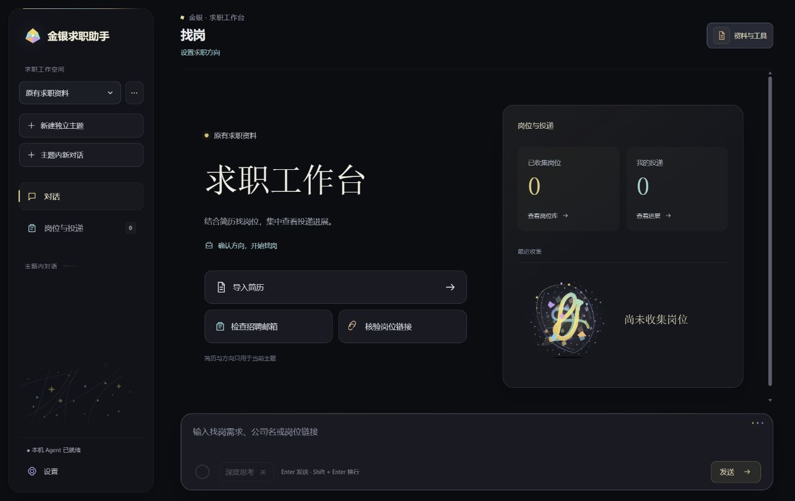

# 金银求职助手

面向个人求职的本地 Agent：结合简历与求职条件查找岗位，核对已有记录，并整理招聘邮件中的投递进展。

这是一个 **Windows 本地应用**。双击程序后会在浏览器中打开界面，后台服务在本机运行。下载包包含运行环境，无需安装 Python；目前不提供 Android APK 或在线公共服务。

**[下载 Windows 版](https://github.com/hersonbill/jinyin-job-agent/releases/latest) · [查看所有版本](https://github.com/hersonbill/jinyin-job-agent/releases)**

## 如何体验

1. 在 Releases 下载 `Jinyin-Windows-x64-v0.3.0.zip`，完整解压到一个文件夹。
2. 双击文件夹中的 **`Jinyin.exe`**，等待浏览器打开金银求职助手。
3. 在「设置」中填写自己的 **DeepSeek API Key**。模型调用按 DeepSeek 的实际用量计费，程序不附赠 Key 或额度。
4. 导入自己的简历、岗位或投递记录，也可以先直接提出问题。

招聘邮箱是可选功能。只有需要读取自己的招聘邮件时，才配置邮箱与 IMAP 授权码；仅体验岗位查找无需连接邮箱。浏览器页面打开期间请保持程序运行，再次双击会重新打开现有会话。

## 可以做什么

| 功能 | 使用方式 |
| --- | --- |
| 岗位发现与匹配 | 按方向、城市、届别等条件查找岗位，结合简历说明匹配情况，提供来源链接 |
| 岗位库与我的投递 | 导入表格、核对已有记录，保存发现的岗位并更新投递进展，导出整理后的记录 |
| 招聘邮件核对 | 授权后读取招聘邮件，结合已有岗位与投递记录核对测评、笔试、面试等进展 |
| 连续对话与恢复 | 在独立求职主题内追问；保留阶段记录，支持停止后继续处理 |
| 偏好与上下文管理 | 保存求职偏好和长期记忆，管理历史对话及上下文压缩 |
| 过程与用量 | 展示实际工具调用进展，回答后显示 token 用量和费用估算 |

## 实现方式

界面使用 HTML / CSS / JavaScript，本机服务使用 Python / FastAPI / SQLite。
Agent 内核复用 **Deep Agents、LangChain、LangGraph**：模型决定如何理解请求、选择工具与组织回答；程序提供工具边界、执行状态、持久化、恢复和资料读写。

回答发布前，会结合来源证据复查；必要时补充查询并修订，最后再次核对。复查仍由模型参与，不能保证每次判断正确。网页未加载、招聘源受限或证据不足时，应保留不确定性，不能把“没读到”当成“没有岗位”。

## 数据与使用范围

- 下载包不含作者的简历、邮箱、投递记录、API Key 或浏览器登录状态。
- 资料与会话保存在使用者自己的电脑。模型任务会把必要上下文发送到使用者配置的 DeepSeek；联网查询会访问相应网站。
- Key 和邮箱授权码保存在 Windows 凭据存储中，不随发布包分发。
- 目前为个人项目体验版。招聘信息以原网站为准，实际投递与重要进展请自行核对。
- 本仓库用于作品展示与 Windows 发行，暂不公开完整项目源码。

## 技术栈

Python 3.12 · FastAPI · SQLite · Deep Agents · LangChain · LangGraph · DeepSeek · Playwright · PyInstaller

本项目使用的第三方组件由各自作者维护，下载包包含相应组件的许可证信息。
